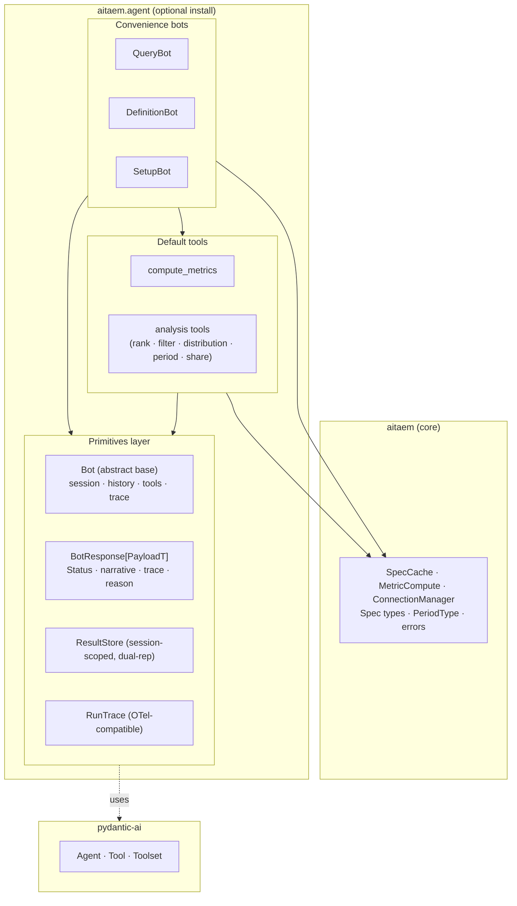
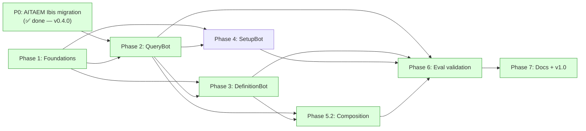
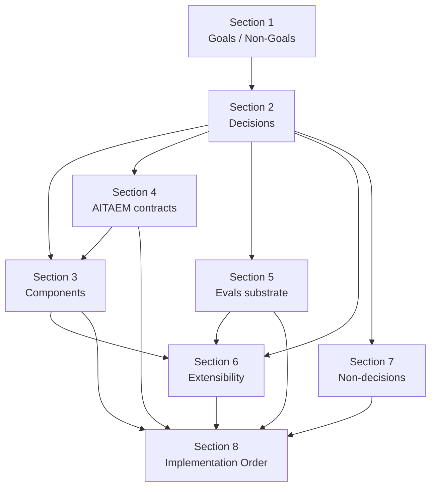

# Architecture: `aitaem.agent` Module

**Version:** 0.3 (Implemented)  
**Date:** Originally June 2026; last updated 2026-08-14  
**Status:** Shipped. `QueryBot` and `DefinitionBot` released in `aitaem[agent]` v1.0.0
(2026-07-23); both bots were extended afterward by Plans 33–37, all released in v2.0.0
(2026-08-12). This document is now a living record of the module as built, not a
pre-implementation proposal — the "Open Questions" section at the end is resolved/closed
throughout except where a decision remains genuinely deferred (cross-referenced to Section 7).

---

## Document Map

This is the master document. Each section also exists as a standalone Markdown file in `./` for independent reference:

| # | Section | File |
|---|---|---|
| 1 | Goals & Non-Goals | [`./01-goals-non-goals.md`](./01-goals-non-goals.md) |
| 2 | Architectural Decisions | [`./02-architectural-decisions.md`](./02-architectural-decisions.md) |
| 3 | Component Architecture | [`./03-component-architecture.md`](./03-component-architecture.md) |
| 4 | Contracts with AITAEM Core | [`./04-aitaem-contracts.md`](./04-aitaem-contracts.md) |
| 5 | Evals Substrate | [`./05-evals.md`](./05-evals.md) |
| 6 | Extensibility Surface | [`./06-extensibility.md`](./06-extensibility.md) |
| 7 | Explicit Non-Decisions | [`./07-non-decisions.md`](./07-non-decisions.md) |
| 8 | Implementation Order | [`./08-implementation-order.md`](./08-implementation-order.md) |

---

## Executive Summary

`aitaem.agent` is an **optional install** (`pip install aitaem[agent]`) that ships agent primitives and three opinionated convenience bots — `QueryBot`, `DefinitionBot`, `SetupBot` (deferred to v1.x — see Phase 4 below) — on top of AITAEM's deterministic compute layer. The goals: collapse AITAEM onboarding to two lines of code, serve as a blueprint for custom agentic applications, and preserve AITAEM core as a quiet library with no LLM dependencies.

**Foundational decisions:**

- **pydantic-ai** is the agent runtime. Provider-agnostic via model strings.
- **One-way dependency.** `aitaem.agent` depends on `aitaem`; never the reverse.
- **Bot is the session.** Multi-turn (`chat()`) is the primary API; single-turn (`ask()`) is a subset. Bots are constructed per user/session; conversation state lives on the bot.
- **Result store is a bot field.** Tools return minimal LLM-facing summaries to save tokens; full artifacts live in the bot's result store, addressable by ID. History serialization preserves both messages and artifacts.
- **Status is an enum** (`ok | empty | refused | error`), not a bool. The `refused` state is the AITAEM-general version of "no spec precisely answers — don't substitute approximation."
- **Trace is aggregated and OTel-compatible** on each response. Designed eval-friendly from day one. Event-stream hooks are a future extension point.
- **Ibis-based result handling** (AITAEM v0.4.0). Result store carries dual representation (Arrow artifact + optional live Ibis ref). Analysis tools prefer lazy mode for warehouse pushdown; fall back to eager when ref is gone.
- **`MetricCompute` is constructed fresh per `compute_metrics` call** (AD-16, revised — Plan 30) — a stateless wrapper around the bot's held `spec_cache`/`connection_manager`; no bot-held instance. Live Ibis refs instead reference into `ConnectionManager`'s cross-backend scratch DuckDB, valid for the bot-held `ConnectionManager`'s lifetime regardless of how `MetricCompute` is scoped.
- **No AITAEM operational-parameter passthrough exists today** (AD-17, dormant — Plan 30). `MetricCompute` takes only `spec_cache`/`connection_manager`. If AITAEM reintroduces an operational parameter, opaque `compute_kwargs` pass-through is the reactivation design.

**Evals.** The architecture commits to a substrate (OTel-compatible trace + portable history + result retrieval). **pydantic-evals** was adopted as the sole eval library (`tests/evals/`, `tests/test_agent/test_otel_spans.py`) — `deepeval` was never added, since no RAG-flow feature has shipped that would need it; it remains an option if one does. Inspect AI remains a future option for capability/safety benchmarks, not yet adopted.

**Implementation order — shipped.** All seven phases described in Section 8 are complete: foundations → QueryBot → DefinitionBot → composition primitives → eval validation → docs and v1.0 release. `aitaem[agent]` v1.0.0 shipped `QueryBot` + `DefinitionBot` on 2026-07-23; `SetupBot` (Phase 4) remains deferred to a later v1.x release — no code exists for it yet. Since v1.0.0, Plans 33–37 extended both bots — spec commit/update/delete (`DefinitionBot`), Ibis-native query building, backend-correct source URI resolution, and backend-pushed-down distribution tools on both bots — all released in v2.0.0 (2026-08-12). See the updated Section 8 for the full phase-by-phase status and the post-v1.0 plan list.

**Open questions — resolved:**

1. Eval library choice: **pydantic-evals**, as recommended. No `deepeval`/Inspect AI adopted; `tests/evals/` and the OTel span-verification suite (`tests/test_agent/test_otel_spans.py`) both run against it in CI. (Section 5, §4)
2. Implementation phasing: followed as proposed, with Phase 5.2 (composition) deliberately reordered ahead of Phase 4 (`SetupBot`) — see Section 8's reordering note. (Section 8)

---

## 1. Goals & Non-Goals

> Full text: [`./01-goals-non-goals.md`](./01-goals-non-goals.md)

### Goals (G1–G8)

- **G1.** Two-line AITAEM onboarding via convenience bots.
- **G2.** Self-evidencing blueprint for AITAEM extension.
- **G3.** One-way dependency, optional install — `aitaem` core remains LLM-free.
- **G4.** Multi-turn architecture from day one.
- **G5.** Eval substrate compatibility (trace + history + result retrieval).
- **G6.** Token-efficient by construction (tools return summaries; artifacts live in result store).
- **G7.** Provider-agnostic LLM layer via pydantic-ai model strings.
- **G8.** Composable tool surface (constructor / add / per-call).

### Non-Goals (NG1–NG9)

- **NG1.** Credential storage, persistence, multi-tenancy, RBAC.
- **NG2.** Streaming response API in v1.
- **NG3.** Event-stream observability hooks in v1.
- **NG4.** Typed error taxonomy in v1.
- **NG5.** Rich default-prompt customization API in v1.
- **NG6.** Locked default tool catalogue beyond the working set.
- **NG7.** Tool removal (per-call injection covers the scoped case).
- **NG8.** Hosting — AITAEM stays a PyPI library.
- **NG9.** Hot-reload of `SpecCache`.

Section 1 elaborates each with rationale.

---

## 2. Architectural Decisions

> Full text: [`./02-architectural-decisions.md`](./02-architectural-decisions.md)

Seventeen committed decisions. Listed compactly here; consult Section 2 for context, rationale, and consequences per decision.

| ID | Decision |
|---|---|
| AD-01 | `aitaem.agent` is an optional install (`aitaem[agent]`); one-way dependency from agent to core |
| AD-02 | pydantic-ai is the agent runtime; provider-agnostic via model strings |
| AD-03 | Module shape: primitives layer + convenience bots layer, both first-class |
| AD-04 | Bot is the session; constructed per user/session |
| AD-05 | Result store is a bot field; responses carry IDs; history serialization includes artifacts |
| AD-06 | Per-bot typed response payloads over a common base |
| AD-07 | `Status` is an enum (`ok / empty / refused / error`), not a bool |
| AD-08 | Aggregated `RunTrace` on response now; event-stream hooks later |
| AD-09 | Architecture commits to eval substrate, not framework; substrate is OTel-compatible |
| AD-10 | Tools return minimal LLM-facing summaries; full artifacts in result store |
| AD-11 | Tool composition: constructor `tools=[...]`, `add_tool()`, per-call `extra_tools=[...]` |
| AD-12 | Ibis-based dual-representation result store (AITAEM v0.4.0) |
| AD-13 | STANDARD_COLUMNS accessed by name, never by index |
| AD-14 | No raw YAML parsing in the agent module; typed attributes only |
| AD-15 | Multi-turn is architectural default; `ask()` is a subset |
| AD-16 | `MetricCompute` constructed fresh per `compute_metrics` call (revised, Plan 30) |
| AD-17 | `compute_kwargs` passthrough — dormant, not currently implemented (revised, Plan 30) |

---

## 3. Component Architecture

> Full text: [`./03-component-architecture.md`](./03-component-architecture.md)



### Components in one paragraph each

- **Primitives layer:** `Bot` (abstract base owning session, history, tools, trace assembly — `aitaem/agent/base.py`), `BotResponse[PayloadT]` (status / narrative / trace / reason / typed payload), `ResultStore` (session-scoped dict of result IDs to artifacts, with optional live Ibis refs), `RunTrace` (per-turn OTel-compatible aggregated record), history I/O surface (`dump_history()` / `load_history()` serializing messages and artifacts together). Composition primitives `add_tool()`, constructor `tools=[...]`, and per-call `extra_tools=[...]` are implemented and tested (`tests/test_agent/test_composition.py`); `add_bot()`/`as_tool()` exist as method stubs but `as_tool()` still raises `NotImplementedError` — see ND-11.
- **Convenience bots layer:** `QueryBot` (intent-gated metric resolution + compute + analysis on AITAEM specs), `DefinitionBot` (schema introspection + spec drafting/validation/commit/update/delete + data-grounded threshold guidance), `SetupBot` (connection wizard returning config; caller persists — **not yet implemented**, deferred to a later v1.x release).
- **Default tools:** `compute_metrics` (the single AITAEM-touching tool, post-Ibis-migration aware) + analysis tools operating on result store entries (`rank_by_value`, `filter_by_threshold`, `distribution_summary`, `column_distribution`, `period_over_period`, `contribution_share`) on `QueryBot`; `column_distribution`/`distribution_summary`/`date_range`/`compute_metrics` are also registered on `DefinitionBot` (Plan 37) so it can ground wildcard/threshold spec decisions in live data instead of guessing.
- **Caller responsibilities:** building `SpecCache` and `ConnectionManager`, choosing the model, per-user lifecycle, persisting history if desired, rendering responses. The library handles none of these.

A typical multi-tool turn (compute → rank → narrate) is illustrated as a sequence diagram in Section 3, §5. Key property: the LLM never sees the full DataFrame; only summaries. The caller dereferences result IDs after the turn.

---

## 4. Contracts with AITAEM Core

> Full text: [`./04-aitaem-contracts.md`](./04-aitaem-contracts.md)

**One-way:** `aitaem.agent` → `aitaem`. Never reverse. Enforced by CI import-graph check.

**Imports from `aitaem` top level (no submodules):**
- Types: `SpecCache`, `MetricSpec`, `SliceSpec`, `SegmentSpec`, `IbisConnector`, `ConnectionManager`, `MetricCompute`, `PeriodType`, `METRIC_FORMAT_VALUES`.
- Exceptions: `AitaemError`, `SpecValidationError`, `SpecNotFoundError`, `TableNotFoundError`. Plus one agent-owned exception that is *not* imported from core: `WrongEntryKindError` (`aitaem/agent/store.py`), a `ResultStore`-specific subclass of `AitaemError`.

Corrected 2026-08-14 against actual usage: `ValidationResult` was removed from the Types list —
not imported or referenced anywhere in `aitaem/agent/` (`validate_spec` consumes
`spec.validate()`'s `.valid`/`.errors`/`.referenced_columns` by duck typing without naming the
return type). `QueryBuildError`, `QueryExecutionError`, and `AitaemConnectionError` were removed
from the Exceptions list for the same reason — none currently referenced in `aitaem/agent/`.

**Assumed AITAEM v0.4.0 behaviors:**
- `MetricCompute(spec_cache, connection_manager)` — constructed fresh per `compute_metrics` call (AD-16, revised).
- `MetricCompute.compute(...)` returns `ibis.Table` (lazy).
- `.to_pandas()` / `.to_pyarrow()` for explicit materialization.
- No operational-parameter passthrough exists today; `compute_kwargs` is AD-17's dormant reactivation design, not current behavior.
- `STANDARD_COLUMNS` schema (11 columns) accessed by name; metadata columns identifiable by name set; `metric_value` is the value column.

**The agent module never:**
- Imports from `aitaem` submodules.
- Parses raw spec YAML.
- Handles credentials directly.
- Instantiates `IbisConnector` or backend-specific connections.
- Persists anything to disk or network.
- Picks defaults for AITAEM operational parameters.

> **Known drift (verified 2026-08-14):** the "no submodule imports" rule is not currently
> enforced by CI — `scripts/check_import_graph.py` only checks the *direction* (core never
> imports `aitaem.agent`), not import style — and several files import past the top level today:
> `aitaem/agent/common_tools.py`, `aitaem/agent/definition_tools.py`, and
> `aitaem/agent/store.py` import exceptions via `aitaem.utils.exceptions` rather than `aitaem`;
> `aitaem/agent/resolver.py` and `aitaem/agent/definition_tools.py` import `MetricSpec`/
> `PeriodType` via `aitaem.specs.metric`/`aitaem.query.builder`. All of these names are also
> exported at the `aitaem` top level, so this is a style drift, not a functional break — flagged
> here rather than silently doc-papered-over or fixed as a side effect of this update.

Section 4 documents the full surface plus the dual-representation result store mandated by the Ibis migration.

---

## 5. Evals Substrate

> Full text: [`./05-evals.md`](./05-evals.md)

### The substrate

Three things the architecture surfaces for any eval harness:

1. **`RunTrace` per response.** OTel-compatible by design. Each `ToolCall` carries name, structured args, result ID, LLM-facing summary, success, duration. Replay-sufficient given `(history-before-turn, user message, trace)`.
2. **`dump_history()`.** JSON-serializable, portable record of the conversation.
3. **`bot.get_result(result_id)`.** On-demand access to materialized artifacts for ground-truth comparison.

**Why this is special:** AITAEM's deterministic compute means evals can include exact-correctness checks (does the computed DataFrame equal the known ground truth?), not just LLM-as-judge on narrative. This is a stronger signal than most LLM apps can produce.

### Library trade-off summary

| Dimension | pydantic-evals | deepeval | Inspect AI |
|---|---|---|---|
| Alignment with pydantic-ai | Native (same authors) | Pytest integration first-class | Generic; solver wrapper |
| Tool-call evaluation | OTel span_tree (structural) | `ToolUseMetric` (LLM-judge) | Solver/scorer (flexible) |
| Multi-turn ergonomics | Roll your own | `ConversationalTestCase` (turnkey) | Native |
| Deterministic correctness | Excellent (EqualsExpected, span checks) | Possible via custom metrics | Excellent |
| RAG metrics out-of-box | None | RAG triad + multi-turn RAG | None |
| Observability | OTel + Logfire native | Confident AI cloud (opt-in) | Built-in viewer |
| LLM-judge bias | Minimal | Pervasive | Optional |
| Adoption / maturity | Newer, well-built | Established, broad | Mature (AISI / labs) |

### Recommendation (non-binding)

**Primary: pydantic-evals.** Tightest alignment with our trace substrate (OTel span_tree), strongest deterministic-correctness story, native Logfire/OTel for observability synergy.

**Complement: deepeval, for RAG flows when they arrive.** Mature RAG triad and multi-turn RAG metrics that pydantic-evals doesn't have. Two frameworks coexist trivially.

**Future option: Inspect AI** for capability/safety benchmarks (prompt injection resistance, etc.). Post-v1.

Section 5 details the substrate, candidate analysis, and explicitly flags the open question of whether to ship reference evals in the repository.

---

## 6. Extensibility Surface

> Full text: [`./06-extensibility.md`](./06-extensibility.md)

Five extension points:

| ID | Surface | Use case |
|---|---|---|
| EP1 | Custom tools (constructor / add / per-call) | Add domain logic; e.g. logging or auditing tools |
| EP2 | Cross-bot delegation via plain-function wrapping | Wrap a bot's `ask()` in a function, attach with `add_tool()`; generic `as_tool()`/`add_bot()` deferred (ND-11) |
| EP3 | Custom bots from primitives | Downstream apps building their own bots on the primitives layer |
| EP4 | Prompt overrides (subclass-first; richer API later) | Customize default prompts per deployment |
| EP5 | Response payload extension | App-specific UX fields (e.g. visualization hints) in a payload subclass |

**Stability guarantees:**
- Convenience bot constructors and primitives base classes: semver-stable.
- Default tool input/output schemas: semver-stable.
- Default prompts: public but not semver-stable in content (tuning is expected).
- `RunTrace` and `BotResponse` field shapes: semver-stable (eval substrate is contract).

**Not enabled:** modifying result store schema, removing default tools by name, hot-swapping the LLM runtime away from pydantic-ai, persistent state owned by the bot.

---

## 7. Explicit Non-Decisions

> Full text: [`./07-non-decisions.md`](./07-non-decisions.md)

Nine things deliberately deferred, each with an "escape valve" describing the path forward we leave open:

| ID | Non-decision | Escape valve |
|---|---|---|
| ND-01 | Streaming response API | `chat_stream()` as parallel method later |
| ND-02 | Event-stream observability hooks | `bot.on(...)` / `bot.events` async iterator |
| ND-03 | Typed error taxonomy | Additive `error_kind` enum later |
| ND-04 | Rich prompt customization API | Kwarg / fragment / registry — all purely additive |
| ND-05 | Default analysis tool catalogue composition | Refine in v1.x based on usage data |
| ND-06 | Cost/token-budget controls | Wrap pydantic-ai's `UsageLimits` later |
| ND-07 | Hot-reload of `SpecCache` | `bot.reset(spec_cache=...)` later |
| ND-08 | Concurrent calls on same bot | Document as unsupported; lock if needed |
| ND-09 | Reference eval harness in repo | **✅ Resolved (Plan 29)** — shipped as `tests/evals/`. See `07-non-decisions.md` ND-09. |
| ND-10 | Multi-turn interactive refinement for DefinitionBot | `chat()` is provided; dedicated multi-turn spec-refinement UX is v1.x once usage patterns are established. Same deferral applies to QueryBot. See `plans/agent_module/07-non-decisions.md`. A concrete escape valve (a `get_prior_spec` tool recovering a prior turn's validated YAML from `ResultStore`) is drafted in `plans/40-definitionbot-multiturn-chat.md` but **not yet implemented** — no such tool exists in `aitaem/agent/definition_tools.py` today. |
| ND-11 | `Bot.as_tool()` / `Bot.add_bot(other_bot)` — generic bot-as-tool composition | Wrap `ask()` as a plain function and register it via `add_tool()`; a generic `as_tool()`/`add_bot()` can be layered on top later, purely additively |

Each non-decision identifies the trigger that would cause us to revisit it.

---

## 8. Implementation Order

> Full text: [`./08-implementation-order.md`](./08-implementation-order.md)



**Phases:**

- **P0** — AITAEM Ibis-return migration + `tmp_dir` cross-backend support. **Shipped in AITAEM v0.4.0.** Phase 2 unblocked.
- **Phase 1 — Foundations. ✅ Shipped.** Package structure, optional install, primitives skeleton, trace assembly.
- **Phase 2 — QueryBot. ✅ Shipped.** `compute_metrics` constructing `MetricCompute` per call (AD-16, revised), analysis tools (lazy-mode-aware), default prompt with Metric Precision Rule, integration, end-to-end multi-turn tests.
  > **v0.2 update (Plan 26):** QueryBot resolution flow is superseded by a two-tool intent gate (`record_intent` → `resolve_intent` → `compute_metrics(spec_token)`), code-enforcing the Metric Precision Rule. See [`09-querybot-v0.2-design.md`](09-querybot-v0.2-design.md) for design; [`../26-querybot-v0.2.md`](../26-querybot-v0.2.md) for the implementation plan.
  >
  > **Plan 31:** `spec_token` is single-use on success only — a failed `compute_metrics` restores the token, so a retry needs no fresh `record_intent`/`resolve_intent`. Safe under parallel tool calls because the pop is atomic and restore only follows failure, with no suspension point between them. That last condition is what the guarantee rests on; hosts that wrap these tools in an async execution model must supply their own mutual exclusion.
  >
  > **Plan 36:** Two backend-pushed-down distribution tools, `distribution_summary` and `column_distribution`, added to `QueryBot` and factored into a shared `aitaem/agent/common_tools.py` so `DefinitionBot` (Plan 37) can reuse them.
- **Phase 3 — DefinitionBot. ✅ Shipped.** Schema introspection tools, spec drafting/validation tool, integration.
  > **Plan 33:** `commit_spec`/`delete_spec` tools, `SpecCache.update()`/`remove()`, transactional `add()`, and a version counter so `QueryBot` sharing the same `SpecCache` rebuilds its own agent (and LLM-visible catalog) when `DefinitionBot` commits, updates, or deletes a spec — closing a staleness gap where a newly committed spec was queryable but invisible to `QueryBot`'s prompt for the rest of its session.
  >
  > **Plan 37:** `date_range`/`compute_metrics` plus the Plan 36 distribution tools added to `DefinitionBot`, so it can ground wildcard-vs-enumerated and numeric-threshold spec decisions in live data instead of guessing.
- **Phase 4 — SetupBot. Deferred to v1.x — still not implemented as of v2.0.0.** Connection-validation tool, integration.
- **Phase 5 — Composition. ✅ Shipped (Phase 5.2 only).** `Bot(tools=[...])`, `add_tool()`, per-call `extra_tools`. Generic `bot.as_tool()` / `add_bot()` (Phase 5.1) remain deferred — `as_tool()` exists as a stub that raises `NotImplementedError`; see ND-11.
- **Phase 6 — Eval substrate validation. ✅ Shipped (Plan 29).** Reference eval harness (`tests/evals/`, covering both `QueryBot` and `DefinitionBot`), OTel span emission verification (`tests/test_agent/test_otel_spans.py`).
- **Phase 7 — Docs + v1.0 release. ✅ Shipped (Plan 32).** Public API docs, getting-started examples, shipped to PyPI as `aitaem[agent]` v1.0.0 (2026-07-23).

**Post-v1.0 core-library extensions used by the agent module:** Plan 34 (Ibis-native query
building, replacing hand-assembled SQL strings — fixes real BigQuery/Postgres dialect bugs
`DefinitionBot`-drafted specs could trigger), Plan 35 (backend-correct source URI resolution —
fixes `IbisConnector.get_table()` against Postgres and BigQuery project handling). Both are
`aitaem` core changes, not `aitaem.agent` changes, but they directly affect what `DefinitionBot`
and `QueryBot` can safely do against non-DuckDB backends. All of Plans 33–37 shipped in v2.0.0
(2026-08-12).

**Risk concentration (historical):** Phase 2 carried the bulk of the architectural risk during
design — trace assembly faithfulness, tool-summary-vs-store split sufficiency, Metric Precision
Rule effectiveness in practice. All three have since been exercised in shipped code and CI evals
without requiring architectural rework.

---

## Cross-section dependency map

How sections relate, for orientation:



- Sections 1 and 2 establish the foundational position.
- Section 3 (components) is informed by Section 2 (decisions) and Section 4 (what flows in from AITAEM).
- Sections 5 (evals), 6 (extensibility), and 7 (non-decisions) refine specific surfaces.
- Section 8 sequences everything into an implementation plan.

---

## Open Questions Awaiting User Decision

All open questions from the original design phase are now closed. Kept here as a historical
record of what was decided and why — not a live decision queue.

### OQ-1: Eval library choice — closed

Architecture recommended **pydantic-evals primary + deepeval for RAG**. See Section 5, §4.

Resolved: pydantic-evals adopted as sole eval library. `tests/evals/` and
`tests/test_agent/test_otel_spans.py` both run against it in CI (Plan 29, Phase 6). `deepeval`
was never adopted — no RAG-flow feature has shipped that would need its RAG-triad metrics; the
option remains open if one does.

### OQ-2: Reference eval harness in the repository? — closed

(a) Ship `tests/evals/` examples demonstrating pydantic-evals wiring — self-evidencing for users.
(b) Document the substrate only — keeps library leaner.

Architecture leaned (a) for consistency with the blueprint philosophy (G2). See Section 5, §6 and Section 7, ND-09.

Resolved: (a). `tests/evals/` shipped, covering both `QueryBot` and `DefinitionBot`. See `plans/29-agent-phase6-evals.md` and `07-non-decisions.md` ND-09.

### OQ-3: Implementation phasing — closed

With AITAEM v0.4.0 shipped, P0 was done. Phase 1 (foundations) and Phase 2 prep began in
parallel as proposed.

Resolved: followed as proposed, with one deliberate reordering — Phase 5.2 (composition
primitives) was prioritized ahead of Phase 4 (`SetupBot`) and Phase 5.1 (`as_tool()`), since it
depended only on Phases 1–3 and `SetupBot` remained out of scope for v1.0. See Section 8's
reordering note and `plans/28-agent-phase5.2-composition.md`.

### OQ-4: AITAEM-side coordination — closed

AITAEM v0.4.0 delivers the Ibis-return `compute()` and adds `tmp_dir` for cross-backend materialization. The dual-representation result store (Section 3, Section 4 §4) is realizable with the v0.4.0 API. AD-16 (one `MetricCompute` per bot) and AD-17 (opaque `compute_kwargs`) addressed the lifetime and forward-compatibility consequences at the time. (AD-16/AD-17 revised since — see Plan 30.)

Any residual coordination — for instance, AITAEM-side feedback on how callers use `tmp_dir` in multi-tenant scenarios — is post-v1.0 territory.

### OQ-5: Context-window management for long-running sessions

**Problem:** In multi-turn conversations, the accumulated `message_history` passed to each `agent.run()` call grows unboundedly. If history + system prompt + current message exceeds the model's context window, the call fails.

**Solution direction:** pydantic-ai's `ProcessHistory` capability (in `pydantic_ai.capabilities`). Pass a processor callable at agent construction time:

```python
from pydantic_ai.capabilities import ProcessHistory

Agent(model=..., capabilities=[ProcessHistory(my_trimmer)])
```

The processor receives the full message list before every model request and returns a modified list. No built-in trimmer exists in pydantic-ai — must be implemented.

**Key constraint (pydantic-ai issue #2050):** The processor fires before *every* model request, including each step of a tool-call loop. The message list it receives includes mid-run tool call/return pairs. Naive trimming that drops a `ToolReturnPart` without its matching `ToolCallPart` violates provider API constraints. Any trimmer must only remove complete call/return pairs as an atomic unit.

**Token counting:** pydantic-ai provides no tokenizer. A safe approximation is character-count or message-count based trimming. Provider-accurate trimming requires an external tokenizer (e.g. `tiktoken` for OpenAI, already available when `[agent-openai]` is installed).

**Where it lives in code:** `_build_agent()` in each concrete `Bot` subclass. The `Bot` base class docstring (Phase 1) already documents this hook so Phase 2+ implementors know where to plug in.

**Status:** Still unimplemented as of v2.0.0 — no `ProcessHistory` capability is registered on either bot (`_build_agent()` in `query_bot.py`/`definition_bot.py` only passes `ReinjectSystemPrompt`), and no trimmer exists anywhere in the codebase. It did not surface as a blocking issue through Phase 2–7 integration testing or the eval suites, so it remains genuinely deferred rather than scheduled. Revisit if long-running multi-turn sessions (helped along by Plan 40's proposed `get_prior_spec`-based multi-turn refinement, if implemented) start hitting real context limits in practice.
