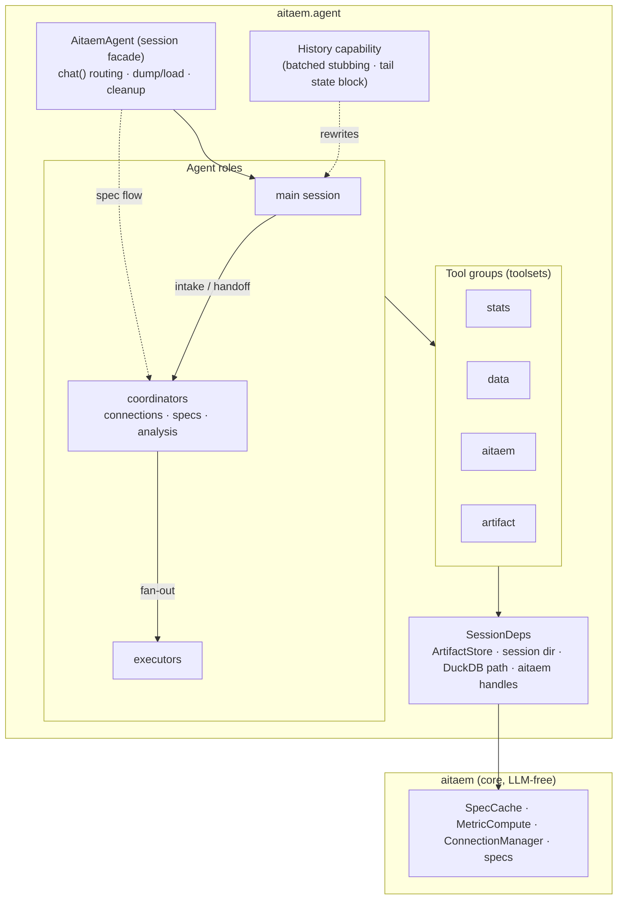
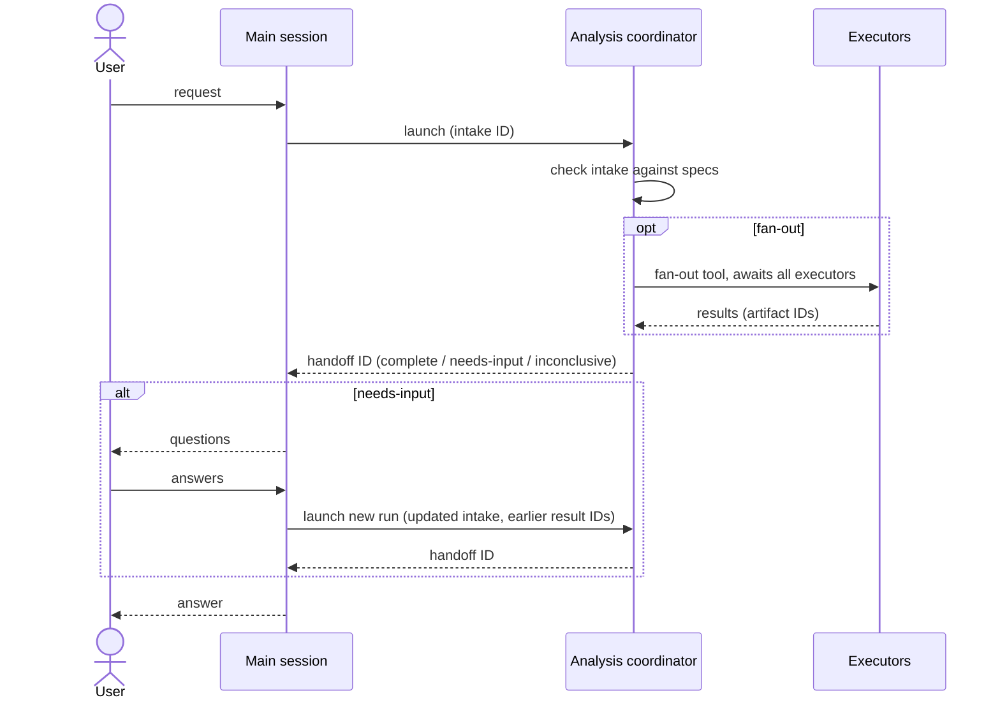
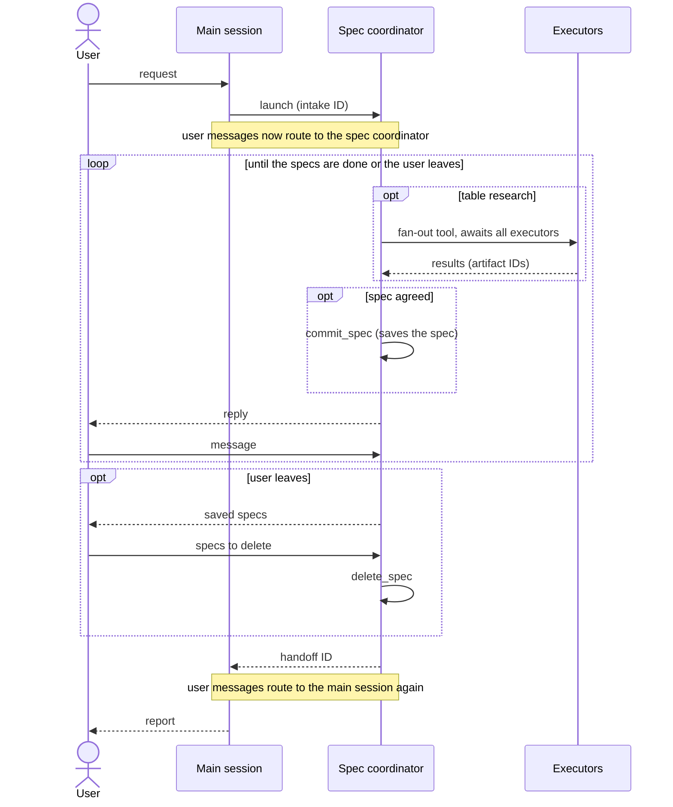

# Architecture: `aitaem.agent` Module (v3 overhaul)

**Version:** 1.3-draft (design, not implemented)
**Status:** Proposed. The v2 design files are archived, as history only, in [`archive/v2/`](archive/v2/).

**This document records decisions only.** Evidence, mechanics, and options considered live in
[`research/agent_module/`](../../research/agent_module/):

| Note | Covers |
|---|---|
| [00-pydantic-ai-2.55-mechanics](../../research/agent_module/00-pydantic-ai-2.55-mechanics.md) | `Conversation`, deferred capabilities, harness assessment, testing, version minimums |
| [00-anthropic-prompt-caching](../../research/agent_module/00-anthropic-prompt-caching.md) | Prefix order, settings, what breaks the prefix, tail block, worker caching |
| [00-history-stubbing](../../research/agent_module/00-history-stubbing.md) | Rewrite costs, hooks, orphan repair, thinking-block binding, compaction |
| [00-subagent-mechanics](../../research/agent_module/00-subagent-mechanics.md) | Delegation primitives, concurrency, harness `SubAgents`, code- vs LLM-driven fan-out |
| [00-workflow-options](../../research/agent_module/00-workflow-options.md) | Main session / coordinator / executor workflows, handoff format |
| [00-result-storage](../../research/agent_module/00-result-storage.md) | v2 result handling, lazy Ibis refs vs local copies, cross-backend results, compute lock |
| [specs/41-spec-yaml-persistence](../../research/specs/41-spec-yaml-persistence.md) | Saving specs as YAML, fsspec, dependency placement |

Decisions marked **†** rest on a research finding still marked **[verify]**; each must be
confirmed with a `FunctionModel` test before implementation relies on it.

---

## 1. Summary

Replace the two task-specific bots with **one multi-turn agent session**: a thin **main session**
talks to the user and delegates each task to a **coordinator**, which may fan out parallel
**executors**. Each of these agent roles has its own instructions and only the tools it needs, drawn from
**modular tool groups**. All data exchange between tools and agents goes through a **session-scoped
artifact store**; the LLM context only ever sees short summaries and artifact IDs.

Design pillars:

1. **Modular tool groups** (stats, data, aitaem, artifact), each an independent toolset.
2. **Agent roles:** the main session, one coordinator per task type (connections, specs, analysis), and their executors; each role has its own instructions and tools.
3. **Executors** spawned by deterministic fan-out tools for parallel work.
4. **Artifacts as the only data channel:** Python objects (by ID), temp files (by path), DuckDB tables (by path + table name), lazy Ibis compute results (by ID).
5. **Every tool call produces a persisted artifact**, registered in a manifest that doubles as the memory index.

Decisions (justified in [00-workflow-options](../../research/agent_module/00-workflow-options.md),
[00-result-storage](../../research/agent_module/00-result-storage.md),
[specs/41-spec-yaml-persistence](../../research/specs/41-spec-yaml-persistence.md)):

| Question | Decision |
|---|---|
| Fate of `QueryBot`/`DefinitionBot` | Removed in **v3.0** (breaking). No deprecation shims. |
| Artifact storage | Per-session directory under the system temp dir (`/tmp`-style), auto-cleaned by the OS; no caller-managed persistence. |
| Providers | Anthropic-first; other providers work with graceful degradation. |
| Target model | The module must work on Haiku wherever possible; the main session's context is kept minimal. |
| Main session role | Talks to the user, writes intake documents, reads handoffs. Delegates every task that computes metrics or changes specs or connections. May itself recall values of already-computed metrics and run basic stats tools on those results; this is also what lets it draft correct intakes for the analysis coordinator. |
| Coordinator roster | One coordinator per task type: connections, specs, analysis. The connections coordinator has no executors and carries out the task itself. |
| Spec design workflow | The main session suspends; the spec coordinator converses with the user directly until it writes its handoff and returns control. Each spec is saved when the coordinator commits it; there is no save step at the end of the flow. If the user leaves the flow, the coordinator lists the saved specs, deletes any the user doesn't want, then ends with its handoff. |
| Connections and analysis workflows | The coordinator never talks to the user. Its handoff is **complete** (answer + result IDs), **needs-input** (questions + result IDs), or **inconclusive** (reason + result IDs). On needs-input, the main session asks the user and re-spawns the coordinator with an updated intake that reuses the earlier results by ID. |
| When a coordinator may stop | Never while executors are running; only before dispatch or after all executors have returned and their results are reviewed. Enforced structurally: the fan-out tool awaits every executor. Applies to all coordinators, including the spec coordinator's dialogue with the user. |
| Coordinator → executors | Coordinators fan out identical executors via written task instructions; executors return results individually; the coordinator compiles them and resolves or flags conflicts. |
| Requests spanning several coordinators | Run one after the other. The main session reads each coordinator's handoff before writing the next intake. Coordinators never hand off to each other. |
| Compute results | Kept as lazy Ibis refs on the source backend, never materialized whole. Stats and previews run as queries on the source backend. No local cache. |
| Small tool outputs | Outputs of stats and data tools (aggregates, top-N, previews, profiles) are stored locally in `session.duckdb`. |
| Tool results vs handoffs | Tool results are Pydantic models. Agent-to-agent intake and handoff documents are YAML written by the agents: only `outcome`, `result_ids`, and `questions` are schema-checked; everything else is free text. |
| Spec persistence | Through core `SpecCache.save()` as YAML files. The spec coordinator saves to the session directory by default (no user-supplied path); the caller may pass a local path or an fsspec URL instead. |
| Agent code placement | One package per agent role under `agent_roles/`, the main session included; each holds the role's `instructions.md` and `agent.py`. Separate from `tools/` (§3). |
| Skills | Current choice: stand-alone tasks go to subagents instead of loaded skills. Each role's instructions are its own static prompt, and its `agent.py` lists the tools its job needs (§6.2). Skills may be added later where they help. |

Because `stability.md` promises semver stability for `QueryBot`, `DefinitionBot` and their tools, the v3.0 release must
list every removed public name in the changelog and `stability.md` (see §11).

---

## 2. Goals and non-goals

**Goals**

- G1. One agent class (`AitaemAgent`) and one user-facing `chat()`; every capability is reached through agent roles.
- G2. Tools grouped by function; groups are usable and testable independently, and composable by callers.
- G3. Parallel subagents with isolated context and no data passed through LLM text.
- G4. Every tool call leaves a durable, typed artifact; the manifest is the session's ground truth.
- G5. Cheap and cache-friendly: stable prompt prefix, append-only history by default, progressive disclosure.
- G6. Concise history: large payloads never enter messages; old results are stubbed to artifact references.
- G7. Keep what already works: `aitaem` core stays LLM-free, one-way dependency, `Status` semantics, OTel-compatible tracing, eval substrate.

**Non-goals (this version)**

- Credential storage, multi-tenancy, hosting.
- Cross-session persistence (the OS may delete the session directory; callers who want durability export artifacts themselves, or pass a spec save location, §1).
- Concurrent turns on the same session.
- Streaming API.
- Provider-native features as hard requirements (they are optimizations only).

---

## 3. Component overview



Module layout:

```
aitaem/agent/
├── __init__.py          # AitaemAgent, public types
├── session.py           # AitaemAgent facade: chat() routing, Conversation dump/load, cleanup
├── deps.py              # SessionDeps
├── artifacts.py         # ArtifactStore, ArtifactRef, kinds, manifest
├── history.py           # stubbing capability, tail state/index block
├── tools/               # every tool that operates on data, grouped by function
│   ├── stats.py         # sort/rank, summary statistics, distributions, period-over-period
│   ├── data.py          # list tables, describe schema, sample, date_range, column profile
│   ├── aitaem.py        # connect, load specs, validate/commit/delete spec, compute_metrics
│   └── artifacts.py     # list/describe/preview/drop artifacts
└── agent_roles/         # one package per agent role
    ├── main_session/
    │   ├── instructions.md   # the role's static instructions
    │   └── agent.py          # Agent definition: model, tools, deps, output
    └── <role>/               # coordinators and executors
        ├── instructions.md
        └── agent.py          # as above, plus its intake/handoff schema and the tool that launches it
```

Rules:

- `tools/` holds the functions that operate on data (`stats`, `data`, `aitaem`, `artifact`).
- Every agent, the main session included, is a role in `agent_roles/` with the same two files. A
  launch tool is a thin wrapper around a run of the agent it launches, so it lives in that role's
  `agent.py`.
- `agent_roles/` imports `tools/`; `tools/` never imports `agent_roles/`, so data tools cannot
  launch agents.
- A role imports only the launch tools of the roles it launches (main session → coordinators →
  executors).
- No shared prompt module: each role's `instructions.md` is self-contained.

---

## 4. Artifact store (the data channel)

### 4.1 Session directory

Created at session start under the system temp directory; contents:

```
<tmp>/aitaem-session-<uuid>/
├── manifest.jsonl         # append-only: one record per artifact
├── objects/<id>.json      # python-object artifacts
├── files/<id>.<ext>       # file artifacts (parquet, csv, text, intake/handoff YAML)
├── specs/                 # default SpecCache.save() location (metrics/, slices/, segments/)
└── session.duckdb         # scratch DuckDB; one table per local table artifact
```

Cleanup is delegated to the OS; `AitaemAgent.cleanup()` exists for eager removal. Consequence: a
session cannot be resumed after the OS has purged its directory, and `load` must tolerate missing
artifacts (the manifest marks them `lost`; see §9.6).

### 4.2 ArtifactRef

Every artifact has a typed record (Pydantic model, JSON-serializable):

| Field | Meaning |
|---|---|
| `id` | Short stable ID, e.g. `a017` (monotonic per session, readable by the LLM) |
| `kind` | `object` · `file` · `table` · `ibis` |
| `type_tag` | Semantic type: `spec_draft`, `metric_result`, `schema_profile`, `relevance_verdict`, `handoff`, … |
| `location` | object: in-memory key + optional serialized path; file: path; table: `(duckdb_path, table_name)`; ibis: in-memory key of the lazy expression (not serialized) |
| `summary` | ≤ 200-char, LLM-facing description (rows/cols, key stats) |
| `produced_by` | tool name + call ID + turn index + (optional) subagent ID |
| `parents` | IDs of input artifacts (lineage) |
| `status` | `ok` · `empty` · `refused` · `error` (the existing `Status` enum) |
| `created_at` | timestamp |

### 4.3 Rules

- **R1. Every tool call writes an artifact.** Even failures and no-ops write an `error`/`empty` artifact so the manifest is a complete trace. A single wrapper enforces this (a `Hooks`/capability `wrap_tool_execute` hook or a tool decorator); tools implement only the payload.
- **R2. Tools return a small `ToolResult`:** `artifact_id`, `status`, `summary`, and optionally a handful of inline facts (≤ ~300 tokens). Never rows.
- **R3. Agents exchange intake and handoff YAML documents, stored as `file` artifacts and passed by ID.** The documents themselves refer to results only by artifact ID.
- **R4. Compute results are `ibis` artifacts; small tool outputs are `table` artifacts in `session.duckdb`.** Subagents receive the database **path** and open their own connection ([00-subagent-mechanics §2](../../research/agent_module/00-subagent-mechanics.md#2-concurrency)). Subagents write namespaced tables (`t_<artifact_id>`); the store registers them.
- **R5. Lineage is mandatory** (`parents`), so the history stubber and the user can trace any result.
- **R6. The store is part of `SessionDeps`**, shared by identity between the main session and its subagents.

### 4.4 Compute results

Compute results stay lazy on the source backend, so large results never leave the warehouse
([00-result-storage](../../research/agent_module/00-result-storage.md)); stats and previews compile
to backend SQL and only their small outputs come back. The warehouse-side distribution tools
move into the `data` and `stats` groups. Results spanning several backends are combined by
core's existing cross-backend path in `ConnectionManager`. An `ibis` artifact does not survive
session reload and is marked `lost` (§9.6); the agent recomputes it.

---

## 5. Tool groups

Tools are plain functions grouped into `FunctionToolset`s, exposed through pydantic-ai
`Capability` objects (or bare toolsets) so callers can include, exclude, prefix, or extend groups.

| Group | Examples | Touches |
|---|---|---|
| `stats` | `sort_rank`, `summary_stats`, `distribution`, `period_over_period`, `contribution_share`, `filter_threshold` | Result artifacts only (`ibis` and `table`); no `ConnectionManager` or aitaem objects. Stats on an `ibis` artifact run as a query on that result's backend. |
| `data` | `list_tables`, `describe_table`, `sample_rows`, `column_profile`, `date_range` | Source backends via `ConnectionManager` (read-only). |
| `aitaem` | `connect_source`, `list_specs`, `resolve_spec`, `validate_spec`, `commit_spec`, `delete_spec`, `compute_metrics` | aitaem core objects; `commit_spec` saves through `SpecCache.save()`. |
| `artifact` | `list_artifacts`, `describe_artifact`, `preview_artifact`, `drop_artifact` | Store only. |

Tools that launch agents are not a tool group; they live in `agent_roles/` (§3).

Principles:

- **Compute lock.** Every tool that executes an Ibis expression (`compute_metrics`, `data` tools, `stats` and `preview_artifact` on `ibis` artifacts) holds one process-wide lock whenever `ConnectionManager.requires_compute_lock` is true (DuckDB registered, or several backends configured), because Ibis DuckDB connections are not thread-safe and executors run in parallel. `SessionDeps` carries the lock, a no-op otherwise, so tools without a `ConnectionManager` can take it. Parallel executors on DuckDB sources therefore execute one at a time ([00-result-storage §5](../../research/agent_module/00-result-storage.md#5-concurrency)).
- **Stable tool list.** The tool array is part of the cached prefix and is fixed and deterministically ordered for the whole session (§8).
- **Semantics:** the Metric Precision Rule (no approximating a spec that doesn't precisely answer the question → `refused`); STANDARD_COLUMNS accessed by name; no raw spec YAML parsing in the agent module (specs go through aitaem's loaders; handoff YAML is parsed and checked against its schema).
- Reuse existing implementations (distribution tools, `validate_spec`, `compute_metrics` internals) by moving them into the new groups; do not rewrite them.

---

## 6. Agent roles

### 6.1 Main session and facade

The main session is a `pydantic_ai.Agent` defined in `agent_roles/main_session/`, wrapped by
`AitaemAgent` (the session facade owning deps, the pydantic-ai `Conversation`s, and `chat()`).
Every role that replies to the user (the main session, and the spec coordinator during spec
design) has a structured output carrying `response` and `attachments`.
`chat(message) → Response` with:

- `response`: the LLM's text.
- `status`: the `Status` enum (`ok` · `empty` · `refused` · `error`).
- `attachments`: a list of (artifact ID, type, reason), the tool-call results the agent attaches
  to support the response, for use by another agent or a visualization step.
- `trace_id`: the chain of steps behind the response (that turn's manifest records, `RunTrace`,
  and OTel spans).

Multi-turn state is carried as a pydantic-ai `Conversation`, passed as `conversation=` on each run,
so `UsageLimits` persist across turns; serialized with `ConversationTypeAdapter`
([mechanics §1](../../research/agent_module/00-pydantic-ai-2.55-mechanics.md#1-multi-turn-state-conversation)).

### 6.2 Instructions and tools

- Each role's instructions are static and loaded from its packaged `instructions.md`, so prompts
  are reviewable as text.
- **Progressive disclosure comes from the roles themselves.** A coordinator's instructions are its
  own prompt in its own context and never enter the main session's context; the main session sees a
  coordinator only through the description of the tool that launches it.
- **Each role's `agent.py` lists the tools its job needs**, from any group. The list is fixed for
  the role's lifetime and kept short, since every tool description is part of the role's prompt (§8).

### 6.3 Workflows

The user always talks to the facade, which routes each message to the active role: the main
session, or the spec coordinator during spec design. The diagrams leave the facade out.

Analysis. The connections coordinator follows the same flow without the fan-out. Each
coordinator launch is a new run; only the main session keeps a `Conversation`.



Spec design. The spec coordinator keeps its own `Conversation` for the flow.



---

## 7. Subagents

### 7.1 Pattern

Each coordinator with executors has one fan-out tool. The coordinator writes one task instruction
per executor; the tool runs identical executors in parallel and awaits all of them (§1). Each
executor writes its handoff as an artifact; the tool returns the handoff IDs with their checked
fields. The coordinator compiles the results and resolves or flags conflicts
([00-subagent-mechanics §4](../../research/agent_module/00-subagent-mechanics.md#4-code-driven-vs-llm-driven-fan-out)).

```
async tool run_executors(ctx, tasks: list[str]) -> ToolResult
    gather(executor.run(task_i, deps=child_deps_i, usage=ctx.usage))
        bounded by a semaphore, return_exceptions=True
    returns: handoff artifact ID + outcome per executor
```

### 7.2 Rules

- Fan-out tools are `async def`.
- Each executor gets a child `SessionDeps` and `usage=ctx.usage`, so the coordinator's `UsageLimits` bound the whole tree.
- Executors default to a cheaper model tier than their coordinator.
- Concurrency is bounded by an `asyncio.Semaphore` in the fan-out tool. If model-level limiting is added, its limiter is used only by the executors. **†**
- The coordinator's `CancellationToken` is passed to its executors.
- Failures: `return_exceptions=True`; failed executors produce `error` artifacts, listed in the fan-out tool's result. Siblings are not cancelled by one failure.
- Executors have no `message_history` and narrow toolsets; they return YAML handoffs (R3) checked by an output validator. **†**
- Every agent is named (`name=`) and instrumented.

### 7.3 Executor caching

Executors use a short, self-contained prompt and run with `Caching(retention=…, messages=False)`;
they do not try to share the coordinator's prefix
([caching §7](../../research/agent_module/00-anthropic-prompt-caching.md#7-parallel-workers)).

---

## 8. Caching

Rules follow from the prefix order and invalidation behavior in
[00-anthropic-prompt-caching](../../research/agent_module/00-anthropic-prompt-caching.md).

- **Setting:** `Caching(retention='1h', messages=True)`; switch to `'5m'` if telemetry shows turns are typically seconds apart.
- **Stable prefix, never mutated mid-session:**
  1. Tool array fixed and deterministically ordered; no per-turn `prepare_tools` or `tool_choice` filtering.
  2. Static instructions are literal strings only.
  3. Session-state block and artifact index are **not** in `instructions`.
- **Tail block:** the session-state block (§9.2) and artifact index (§9.3) are regenerated every request from `SessionDeps` and appended behind a `CachePoint` in `wrap_model_request`, never persisted to history. Because they are rebuilt from the store, they survive history stubbing.
- **Do not toggle** `tool_choice`, thinking params, `effort`, or image presence between turns.
- **Observability:** surface `cache_read_input_tokens`, `cache_creation_input_tokens`, and collapse reason in `RunTrace`; enable `anthropic_cache_diagnostics` in development; check that prompts exceed the target model's minimum cacheable size.
- **Progressive disclosure** comes from agent roles (§6.2). Native tool search is reserved for if the tool count grows large.
- **Other providers:** same structure; Anthropic-only features degrade gracefully.

---

## 9. Multi-turn history

### 9.1 Principle

Append-only by default. When a trigger fires, one batched rewrite runs and the result is persisted
(via the `Conversation`), so the prefix is stable again until the next trigger. Because every tool
result is already a short summary plus artifact ID (R2), growth is slow and rewrites are expected
to be rare ([00-history-stubbing §1](../../research/agent_module/00-history-stubbing.md#1-why-rewrites-are-costly)).

### 9.2 Session-state block

Small structured object, updated deterministically from tool results (not by an LLM), rendered
in the tail block each request: current goal, connected sources, active specs, pending question,
user preferences, unresolved errors. Compact JSON, hard size cap.

### 9.3 Artifact index

The manifest rendered compactly in the tail block (`a017 ibis metric_result "DAU by country"`),
newest entries expanded, older ones collapsed to one line each, growing only by appended lines.
`describe_artifact`/`preview_artifact` give just-in-time detail.

### 9.4 Batched stubbing capability

A custom `ProcessHistory` capability ([00-history-stubbing §2–4](../../research/agent_module/00-history-stubbing.md#2-pydantic-ai-hooks)):

- **Trigger:** `ctx.context_window_used` ≥ ~0.6–0.7, or `prompt_cache_outlook(…) == 'cold'` combined with a smaller size threshold. A `min_clear_tokens`-style floor prevents small rewrites.
- **Action:** replace old, bulky `ToolReturnPart.content` with `[artifact a017 · kind · summary · how to retrieve]` via `dataclasses.replace`. Keep every call/return pair. Leave the last N pairs and the current run untouched.
- **Escalation:** drop whole oldest turns at a user-prompt boundary.
- **Eval:** answer fidelity after stubbing is checked in the eval suite (§11).

### 9.5 Thinking-block binding

The main session runs with thinking off, so stubbing never breaks thinking-block binding on 5.x
Claude models ([00-history-stubbing §5](../../research/agent_module/00-history-stubbing.md#5-thinking-block-binding)).
Coordinators and executors are never stubbed and may use thinking.

### 9.6 Persistence

Every `Conversation` the facade holds, plus the manifest, are dumped/loaded together. Loading with missing artifact
files marks those manifest entries `lost` rather than failing.

---

## 10. Contracts with `aitaem` core

- One-way dependency `aitaem.agent → aitaem`; core never imports the agent.
- Optional install `aitaem[agent]`; `pydantic-ai` is the runtime.
- Import from the `aitaem` top level; `scripts/check_import_graph.py` enforces it.
- `MetricCompute` is constructed per `compute_metrics` call over the session's `SpecCache` / `ConnectionManager`; its lazy `ibis.Table` result is stored as is, not materialized.
- Specs are saved only through `SpecCache.save()`.
- The agent module never handles credentials directly, parses raw spec YAML, or instantiates backend connections outside `ConnectionManager`.

---

## 11. Evals, observability, removal of the v2 bots

**Evals:** pydantic-evals stays. Reuse `tests/evals/` cases for query and definition tasks, retargeted
to `AitaemAgent`. New eval dimensions: fan-out correctness (verdicts match ground truth), artifact
completeness (every tool call has a manifest entry), history-stub fidelity (answers unchanged
after stubbing), cache hit rate on turn ≥ 2.

**Observability:** `RunTrace` per response, extended with artifact IDs per tool call, executor spans
nested under the fan-out tool call, per-run usage, and cache token counts/collapse reason.
OTel-compatible.

**Testing:** `FunctionModel` for the main session and coordinators (deterministic delegation and
fan-out), `TestModel` or `FunctionModel` per executor via `override`
([mechanics §4](../../research/agent_module/00-pydantic-ai-2.55-mechanics.md#4-testing)).

**Removal of the v2 bots (v3.0):**

- Remove `QueryBot`, `DefinitionBot`, their tools, prompts, `ResultStore`, `resolver` gate; record every removed public name in `docs/changelog.md` and `docs/stability.md`.
- Rewrite `docs/api/` agent pages and `mkdocs.yml` nav per the documentation instructions.

---

## 12. Dependency floor

- Set `pydantic-ai-slim>=2.55,<3` (currently `>=2.2.0,<3`): one clean baseline covering every feature used ([mechanics §7](../../research/agent_module/00-pydantic-ai-2.55-mechanics.md#7-minimum-versions-per-feature)).
- Update all five extras in `pyproject.toml` (lines ~46–74) together; CI must exercise the floor version.
